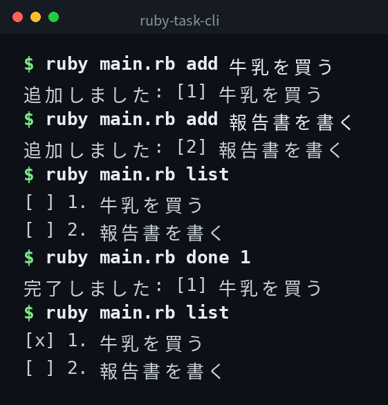

English | [日本語](ja/README.md) | [한국어](ko/README.md)

# ruby-task-cli


## Overview

A simple command-line task management tool. You can add, list, complete, and delete tasks.

## Demo



*Actual output. The CLI interface is in Japanese.*

## Features

- Add tasks with a title
- List all tasks with their status
- Mark tasks as done
- Delete tasks

## Requirements

- Ruby 2.7 or higher

## Quick Start

```bash
git clone https://github.com/mivork/ruby-task-cli.git
cd ruby-task-cli
ruby main.rb add "Buy milk"
ruby main.rb list
```

## Usage

| Command | Description |
|---|---|
| `add <task name>` | Add a new task |
| `list` | List all tasks |
| `done <task ID>` | Mark a task as done |
| `delete <task ID>` | Delete a task |

## Data Format

Tasks are saved in `tasks.json` in JSON format.

```json
[
  {
    "id": 1,
    "title": "Buy milk",
    "done": false,
    "created_at": "2026-11-09T16:00:00+09:00"
  }
]
```

## License

This project is licensed under the MIT License.
