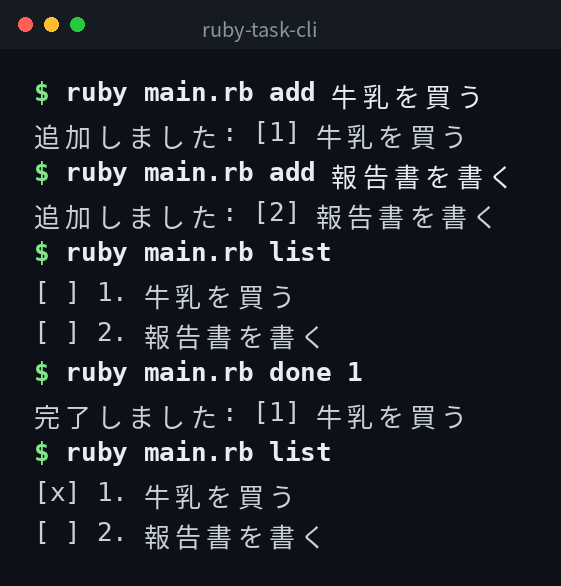

[English](../README.md) | 日本語 | [한국어](../ko/README.md)

# ruby-task-cli


## 概要

コマンドラインで動くシンプルなタスク管理ツールです。タスクの追加・一覧表示・完了・削除ができます。

## デモ



## Features

- タスクをタイトル付きで追加する
- すべてのタスクを状態付きで一覧表示する
- タスクを完了にする
- タスクを削除する

## 必要環境

- Ruby 2.7 以上

## Quick Start

```bash
git clone https://github.com/mivork/ruby-task-cli.git
cd ruby-task-cli
ruby main.rb add 牛乳を買う
ruby main.rb list
```

## コマンド一覧

| コマンド | 説明 |
|---|---|
| `add <タスク名>` | タスクを追加する |
| `list` | タスク一覧を表示する |
| `done <タスクID>` | タスクを完了にする |
| `delete <タスクID>` | タスクを削除する |

## データ形式

タスクは `tasks.json` に JSON 形式で保存されます。

```json
[
  {
    "id": 1,
    "title": "牛乳を買う",
    "done": false,
    "created_at": "2026-11-09T16:00:00+09:00"
  }
]
```

## ライセンス

このプロジェクトは MIT ライセンスの下で公開されています。
