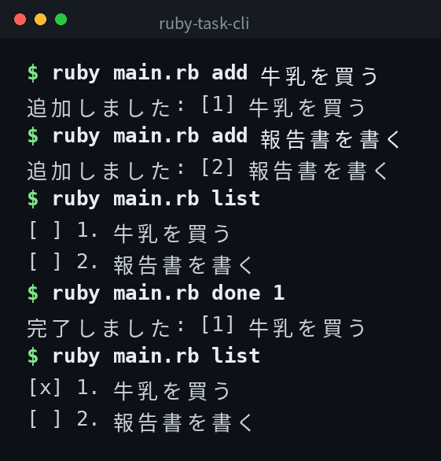

[English](../README.md) | [日本語](../ja/README.md) | 한국어

# ruby-task-cli


## 개요

명령줄에서 동작하는 간단한 작업 관리 도구입니다. 작업을 추가하고, 목록을 표시하고, 완료 처리하고, 삭제할 수 있습니다.

## 데모



*실제 출력입니다. CLI 인터페이스는 일본어입니다.*

## Features

- 제목과 함께 작업을 추가한다
- 모든 작업을 상태와 함께 목록으로 표시한다
- 작업을 완료 상태로 변경한다
- 작업을 삭제한다

## 요구 사항

- Ruby 2.7 이상

## Quick Start

```bash
git clone https://github.com/mivork/ruby-task-cli.git
cd ruby-task-cli
ruby main.rb add "우유 사기"
ruby main.rb list
```

## 사용법

| 명령어 | 설명 |
|---|---|
| `add <작업명>` | 작업을 추가한다 |
| `list` | 작업 목록을 표시한다 |
| `done <작업 ID>` | 작업을 완료 상태로 변경한다 |
| `delete <작업 ID>` | 작업을 삭제한다 |

## 데이터 형식

작업은 `tasks.json` 파일에 JSON 형식으로 저장됩니다.

```json
[
  {
    "id": 1,
    "title": "우유 사기",
    "done": false,
    "created_at": "2026-11-09T16:00:00+09:00"
  }
]
```

## 라이선스

이 프로젝트는 MIT 라이선스 하에 공개되어 있습니다.
